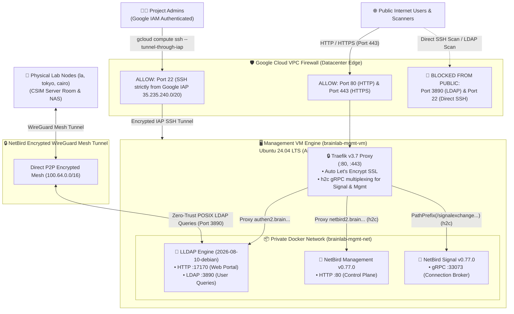

# Sequence 4: Disposable Management VM Engine (`mgmt/terraform/vm`)

## 📌 Overview & Purpose
This is **Sequence 4 of 6** in the management plane infrastructure.

This module provisions the **100% Stateless Management VM** running on Google Compute Engine (`e2-micro`, Ubuntu 24.04 LTS with `Asia/Bangkok` timezone). It automatically installs Docker, configures automated security patching, mounts our Traefik/LLDAP/NetBird stack, and attaches a permanent Static External Public IP.

The state is permanently synchronized in Google Cloud Storage (`gs://ait-brainlab-mgmt-tfstate/vm/default.tfstate`).

---

## 📦 Pinned Production Container Stack

All container images are strictly pinned to verified, deterministic versions:

| Service | Container Image | Version Tag | Port | Purpose |
| :--- | :--- | :---: | :---: | :--- |
| **🔒 Traefik** | `traefik:v3.7` | `v3.7` | `:80`, `:443` | Reverse proxy, automatic Let's Encrypt SSL & HTTP/2 |
| **👤 LLDAP** | `lldap/lldap:2026-08-10-debian` | `2026-08-10-debian` | `:17170`, `:3890` | Lightweight POSIX directory & passwordless mappings |
| **📡 NetBird Dashboard** | `netbirdio/dashboard:0.77.0` | `0.77.0` | `:80` | Web administration UI & user authentication |
| **📡 NetBird Signal** | `netbirdio/signal:0.77.0` | `0.77.0` | `:443` (via h2c) | WireGuard peer signal & WebRTC connection broker |
| **📡 NetBird Management** | `netbirdio/management:0.77.0` | `0.77.0` | `:443` (via h2c) | Central mesh VPN policy, gRPC & control plane |
| **📡 NetBird Relay** | `netbirdio/relay:0.77.0` | `0.77.0` | `:443` (via /relay) | WireGuard TURN/relay fallback broker |
| **📡 NetBird Client** | `netbirdio/netbird:0.77.0` | `0.77.0` | WireGuard | Host peer enrollment and internal mesh tunneling |

---

## 🏗️ Architecture & Network Security Diagram



---

## 🌐 Access URLs & Service Endpoints

### 🧪 Staging Endpoints (For Safe Side-by-Side Testing)
| Service | Staging URL | Purpose |
| :--- | :--- | :--- |
| **👤 LLDAP Web Portal** | `https://authen2.brain.cs.ait.ac.th` | User directory administration & passwordless mappings |
| **📡 NetBird Dashboard** | `https://netbird2.brain.cs.ait.ac.th` | Mesh VPN control plane & device peer management |

---

### 🚀 Production Endpoints (Active Post-Cutover)
| Service | Production URL | Target Host | Access Policy |
| :--- | :--- | :--- | :--- |
| **👤 LLDAP Web Portal** | `https://ldap.brain.cs.ait.ac.th` | Management Control Plane | 🔒 **NetBird Mesh Only (`100.64.0.0/10`)** |
| **📡 NetBird Dashboard** | `https://netbird.brain.cs.ait.ac.th` | Management Control Plane | 🌐 Public (Google OAuth2 SSO) |

---

### 🔒 Internal Zero-Trust Endpoints (NetBird Mesh Only)
| Service | Endpoint | Protocol | Purpose |
| :--- | :--- | :---: | :--- |
| **Internal POSIX LDAP** | `ldap://<netbird-mgmt-ip>:3890` | LDAP | Linux SSSD & TrueNAS NFS user lookups |

---

## 🛡️ Zero-Trust Security & Port Matrix

| Port / Protocol | Firewall Rule Name | Public Access | Purpose |
| :--- | :--- | :---: | :--- |
| **`80` / TCP** | `brainlab-mgmt-allow-web` | 🌐 Public | • Let's Encrypt automated SSL validation (ACME)<br>• Auto-redirects `http://` $\rightarrow$ `https://` |
| **`443` / TCP** | `brainlab-mgmt-allow-web` | 🌐 Public | • Secure HTTPS access to `authen2` and `netbird2` web portals |
| **`33073` / UDP & TCP** | `brainlab-mgmt-allow-netbird` | 🌐 Public | • NetBird WireGuard peer connection broker and signal negotiation |
| **`22` / TCP (SSH)** | `brainlab-mgmt-allow-iap-ssh` | 🔒 **Google IAP Only (`35.235.240.0/20`)** | • **Zero Public Exposure**: Only authenticated Google IAM admins can tunnel in! |
| **`3890` / TCP (LDAP)** | *(No Public Rule)* | 🔒 **NetBird Mesh Only** | • **Zero-Trust**: Only accessible to authenticated NetBird WireGuard mesh peers! |

---

## 💻 How to SSH into the VM (Google IAP Tunnel)

Because Port 22 is completely closed to the public internet, connect securely via Google Identity-Aware Proxy:

```bash
gcloud compute ssh brainlab-mgmt-vm \
  --zone=asia-southeast1-a \
  --project=ait-brainlab-mgmt \
  --tunnel-through-iap
```

---

## 🛠️ Operational Helper Scripts

We provide three pre-configured zero-leakage automation scripts:

### 1. 📺 Live Bootstrap & Log Monitor (`monitor_vm_logs.sh`)
Stream live boot logs, startup script progress, and container outputs directly from the terminal:
```bash
# Interactive menu:
bash monitor_vm_logs.sh

# Or direct modes:
bash monitor_vm_logs.sh 1  # Live startup-script logs (google-startup-scripts.service)
bash monitor_vm_logs.sh 2  # Live Docker Compose logs (Traefik, LLDAP, NetBird)
bash monitor_vm_logs.sh 3  # Serial Console boot logs (Kernel / Hardware)
bash monitor_vm_logs.sh 4  # Container health snapshot (docker ps)
```

### 2. 🔍 Automated Endpoint Health Check (`check_vm_health.sh`)
Verify that both HTTPS staging portals return HTTP 200/302 and Let's Encrypt certificates are active:
```bash
bash check_vm_health.sh
```

### 3. 🛰️ Automated Terraform Waiter (`wait_for_bootstrap.sh`)
Invoked automatically by `terraform apply` to follow the VM's startup script live via Google IAP and confirm container health before finishing.

---

## 🚀 Step-by-Step Deployment Tutorial

### Step 1: Initialize Configuration & Remote State (Task 4.1)
```bash
cd mgmt/terraform/vm
cp terraform.tfvars.example terraform.tfvars
terraform init
```

---

### Step 2: 1-Click Deploy (VM + Static IP + DNS Ingress) (Task 4.2)
```bash
terraform plan
terraform apply
```
Type `yes` when prompted. 

Terraform will automatically:
1. Reserve your permanent Static Public IP (`34.143.234.182`) with `lifecycle { prevent_destroy = true }`.
2. Create `authen2.brain.cs.ait.ac.th` and `netbird2.brain.cs.ait.ac.th` in Cloud DNS.
3. Configure the Zero-Trust Firewall (Port 22 IAP-only, Port 3890 Mesh-only).
4. Launch the `e2-micro` Ubuntu 24.04 LTS VM (Timezone: `Asia/Bangkok`), stream the bootstrap progress live, and start the Traefik/LLDAP/NetBird Docker stack.

---

### Step 3: Automated Health Check (Task 4.3)
Traefik will automatically negotiate Let's Encrypt SSL certificates. Run:

```bash
bash check_vm_health.sh
```

---

## 🛠️ Day-2 Operations & Lifecycle Management

### 1. Permanent IP Safety (`prevent_destroy = true`)
The Static Public IP (`google_compute_address.mgmt_ip`) has `lifecycle { prevent_destroy = true }`. Running an accidental `terraform destroy` will be **hard-blocked by Terraform**, preventing loss of the permanent IP address.

---

### 2. Disposable Rebuild ("100% Cattle")
To completely destroy and rebuild the VM from scratch while keeping the permanent IP:
```bash
terraform apply -replace=google_compute_instance.mgmt_vm
```
Terraform will destroy the old VM, spin up a brand-new instance, pull fresh images, and restore the entire control tower in **under 90 seconds**!

---

### 3. Standby Mode / Cold-Start ($0 Compute Cost)
If you want to tear down the VM to incur $0 compute cost while keeping the permanent IP and DNS:
```bash
# Destroy only the VM:
terraform destroy -target=google_compute_instance.mgmt_vm

# Bring it back anytime:
terraform apply
```

---

### 4. How to Resize the VM (Vertical Scaling)
If you ever want to upgrade from `e2-micro` (1 GB RAM) to `e2-small` (2 GB RAM):
1. Open [`variables.tf`](variables.tf) or `terraform.tfvars` and edit:
   ```hcl
   machine_type = "e2-small"
   ```
2. Run `terraform apply`.  
   *(GCE stops the VM, resizes CPU/RAM, and reboots in ~20s with ZERO IP change and ZERO data loss).*

---

## ⚡ Performance Hardening on `e2-micro`

The management VM runs on an ultra-low-cost `e2-micro` instance (< $7/mo). To ensure rock-solid stability and prevent memory starvation or CPU credit exhaustion, the following hardening is embedded directly into the startup automation:

### 1. Automated 2.0 GB Swapfile (`/swapfile`)
* Ubuntu 24.04 boots with only 1.0 GB physical RAM. Running 7 containers pushes baseline memory to ~650 MB.
* The startup script automatically creates and enables a **2 GB swapfile** with `vm.swappiness = 10`.
* Active network operations (Traefik TLS, NetBird Signal, LLDAP) stay 100% in physical RAM, while inactive OS background processes are safely paged to swap.

### 2. Ultra-Lightweight `curl` GCS Backups (< 3 MB RAM)
* Heavy Python-based CLI utilities like `gcloud storage cp` allocate ~200–250 MB of RAM on startup, which causes memory exhaustion and disk thrashing on an `e2-micro`.
* The automated backup script (`/opt/brainlab/scripts/backup_to_gcs.sh`) uses atomic SQLite snapshots (`nice -n 19 ionice -c 3 sqlite3 ... .backup`) and uploads directly to Google Cloud Storage via native `curl` targeting the GCS REST Upload API with local instance metadata bearer tokens.
* **CPU time**: **0.21 seconds**. **RAM overhead**: **~3 MB**. Total execution time is under 1.5 seconds with zero load spike.

### 3. Masked Background Desktop Services
* Control plane nodes mask `packagekit.service` and disable heavy apt news services on boot, preventing background package indexers from depleting burstable CPU credits.

### 4. High-Performance Boot Storage (`pd-balanced`)
* Configured with `pd-balanced` (120+ IOPS baseline, up to 1,200 burst IOPS) rather than `pd-standard` (30 IOPS baseline), eliminating I/O wait during SQLite transactions and container restarts.

---

## 🔄 Container Version Upgrading Strategy

Upgrades on the management control plane follow a **Two-Tier Model**:

### Tier 1: In-Place Rolling Updates (Zero DNS/IP Downtime — ~5-10s)
For routine container updates (e.g., bumping NetBird from `0.77.0` to `0.78.0` or updating Traefik/LLDAP):
1. Update the version tag in [`variables.tf`](variables.tf).
2. Run the 1-click in-place update script:
   ```bash
   bash update_services.sh
   ```
3. Docker pulls the updated image layers and performs a rolling restart in ~5 seconds.
4. **Zero Downtime**: The public IP does not change, Cloud DNS does not need to propagate, and existing WireGuard mesh tunnels remain connected without dropping.

### Tier 2: VM Rebuild ("Cattle, not Pets")
For OS kernel upgrades, disk type upgrades (`pd-standard` $\rightarrow$ `pd-balanced`), or disaster recovery:
1. Trigger a full replacement in Terraform:
   ```bash
   terraform apply -replace=google_compute_instance.mgmt_vm
   ```
2. Terraform destroys the disposable instance and launches a fresh VM.
3. On first boot, the startup script automatically rehydrates `users.db`, `store.db`, AND `management.json` (containing `DataStoreEncryptionKey`) from GCS in < 2 seconds, preserving all active user sessions and re-establishing the full container stack with zero IP change.

---

## 📋 Live Environment Drift & Rebuild Runbook

### 1. Drift Inventory (Live VM vs. Terraform Repository)

As of November 7, 2026, the live VM (`brainlab-mgmt-vm`) was hardened in-place to resolve memory starvation and restore NetBird authentication. The Terraform IaC codebase has been synchronized with all hardening measures. 

The differences between the currently running instance and a freshly applied Terraform instance are:

| Component | Currently Running Live VM | Terraform IaC Codebase (`mgmt/terraform/vm/`) | Impact of Rebuild |
| :--- | :--- | :--- | :--- |
| **Boot Disk Type** | `pd-standard` (30 baseline IOPS) | `pd-balanced` (120 baseline / 1,200 burst IOPS) | ⚠️ **Forces VM replacement** during `terraform apply`. |
| **2GB Swapfile** | Manually created & mounted on live OS | Fully baked into [`templates/startup-script.sh.tftpl`](templates/startup-script.sh.tftpl) | Created automatically on first boot. |
| **PackageKit** | Manually stopped & masked on live OS | Automatically masked in `startup-script.sh.tftpl` | CPU credits preserved on first boot. |
| **GCS Backup Script** | Hotfixed on live disk (`/opt/brainlab/scripts/backup_to_gcs.sh`) with `curl` | Encoded directly into `startup-script.sh.tftpl` | Installed automatically via template. |
| **GCS State Consistency** | `users.db`, `store.db`, `management.json` synced | Boot script restores all 3 files via `curl` | 100% state preserved; zero session loss. |
| **Dashboard Tag** | Running `:latest` image | Pinned to `netbirdio/dashboard:0.77.0` | Eliminates image drift across restarts. |

> [!NOTE]
> The live VM is fully stabilized, performant (load avg ~0.03, memory ~490 MB used out of 953 MB + 2 GB swap), and all 7 containers are healthy. Rebuilding the VM is **NOT urgent** and can be executed at convenience during a scheduled maintenance window.

---

### 2. Step-by-Step Rebuild Execution SOP

When you are ready to rebuild the VM to apply the `pd-balanced` disk upgrade and eliminate all drift:

#### Step 1: Pre-Rebuild Safety Backup
Trigger an immediate atomic snapshot and verify that all three state files exist in GCS:
```bash
# SSH into live VM via Google IAP
gcloud compute ssh brainlab-mgmt-vm --zone=asia-southeast1-a --project=ait-brainlab-mgmt --tunnel-through-iap

# Run the live curl backup script
sudo /opt/brainlab/scripts/backup_to_gcs.sh

# Verify all 3 files are in GCS and check the DataStoreEncryptionKey SHA:
TOKEN=$(curl -s -H "Metadata-Flavor: Google" "http://metadata.google.internal/computeMetadata/v1/instance/service-accounts/default/token" | jq -r .access_token)
echo "--- Backups in GCS ---"
curl -s -H "Authorization: Bearer $TOKEN" "https://storage.googleapis.com/storage/v1/b/ait-brainlab-mgmt-tfstate/o?prefix=backups" | jq -r '.items[] | "\(.name) (\(.size) bytes, updated: \(.updated))"'
```

#### Step 2: Apply Terraform
From your local workspace, run `terraform apply`:
```bash
cd mgmt/terraform/vm
terraform apply
```
* Terraform will recognize the `initialize_params.type` change from `pd-standard` to `pd-balanced` and will plan:
  ```text
  ~ resource "google_compute_instance" "mgmt_vm" {
      ~ boot_disk {
          ~ initialize_params {
              ~ type = "pd-standard" -> "pd-balanced" # forces replacement
            }
        }
    }
  Plan: 1 to add, 0 to change, 1 to destroy.
  ```
* Type `yes` to proceed.
* Terraform will destroy the old instance, create the new instance with `pd-balanced`, reattach the static external IP, and execute `wait_for_bootstrap.sh` until all containers report healthy (~60–90 seconds total).

#### Step 3: Post-Rebuild Verification Checklist
After Terraform apply completes:
1. Verify memory and swap on the new VM:
   ```bash
   gcloud compute ssh brainlab-mgmt-vm --zone=asia-southeast1-a --project=ait-brainlab-mgmt --tunnel-through-iap --command="free -h && uptime"
   ```
2. Verify all 7 containers are up:
   ```bash
   gcloud compute ssh brainlab-mgmt-vm --zone=asia-southeast1-a --project=ait-brainlab-mgmt --tunnel-through-iap --command="sudo docker ps"
   ```
3. Verify WireGuard mesh peers and NetBird status:
   ```bash
   gcloud compute ssh brainlab-mgmt-vm --zone=asia-southeast1-a --project=ait-brainlab-mgmt --tunnel-through-iap --command="sudo sqlite3 /opt/brainlab/netbird/data/store.db 'SELECT name, peer_status_connected, peer_status_login_expired FROM peers;'"
   ```
4. Access the web endpoints:
   - NetBird Dashboard: `https://netbird.brain.cs.ait.ac.th`
   - LLDAP Admin Portal: `https://ldap.brain.cs.ait.ac.th` (via WireGuard mesh)

---

---

## ➡️ Next Step: Sequence 5 (Identity-as-Code)
Now that the LLDAP engine is running on the VM, proceed to **Sequence 5: Seeding Users, UIDs, and Multi-Email Bindings**:
👉 [**Continue to `mgmt/terraform/identity/README.md`**](../identity/README.md)
