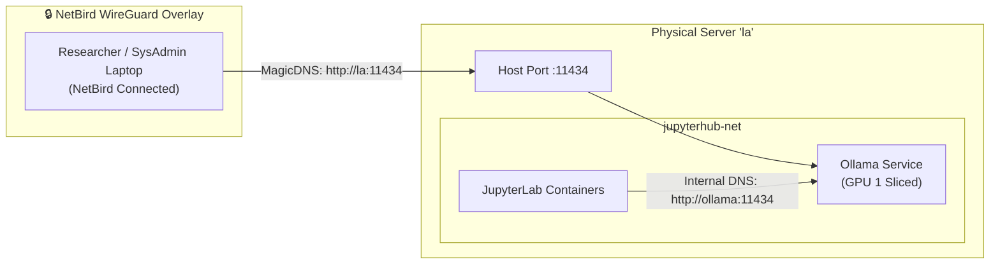

# Ollama LLM Inference Service (`services/ollama`)

## Overview
AIT Brainlab runs a self-hosted **Ollama** large language model inference service alongside [JupyterHub](../jupyterhub/) on physical server `la.cs.ait.ac.th`. It provides local, low-latency, and zero-cost LLM completions and embeddings to researchers, student notebook environments, and NetBird mesh clients without external cloud API dependencies.

---

## 🔒 Access Architecture: Direct Port + NetBird MagicDNS

Following the lab's **Rule 22** (*Zero Internal TLS for Mesh-Internal Services*), Ollama does **not** use Traefik reverse proxying. Instead, it exposes port `11434` directly on host `la`, accessible through the encrypted NetBird WireGuard overlay.



- **NetBird VPN Clients**: Connect directly using NetBird MagicDNS: **`http://la:11434`**. WireGuard provides ChaCha20-Poly1305 encryption and authentication at Layer 3.
- **JupyterLab Notebooks**: Connect internally via Docker bridge: **`http://ollama:11434`**.
- **External / Campus LAN**: Server `la` is protected behind the institutional CSIM firewall (`192.41.170.x`), so unauthenticated non-NetBird traffic cannot reach port 11434.

---

## 🏗 GPU Partitioning (Dual RTX A6000)

The host server `la` is equipped with **dual NVIDIA RTX A6000 GPUs** (48 GB GDDR6 VRAM each, 96 GB total).

- **GPU 0 (First GPU)**: 100% dedicated to JupyterHub multi-user training and deep learning experiments.
- **GPU 1 (Second GPU)**: Sliced:
  - **Ollama**: Assigned exclusively to GPU 1 via `device_ids: ['${OLLAMA_GPU_ID}']`.
  - **Explicit VRAM Headroom**: Declared via `OLLAMA_GPU_OVERHEAD` in `.env`, ensuring Ollama holds back memory for other workloads.

### VRAM Slicing Reference (48 GB RTX A6000)

$$\text{OLLAMA\_GPU\_OVERHEAD} = (\text{Total GPU VRAM} - \text{Target Ollama VRAM}) \times 1024^3$$

| Target Ollama VRAM | VRAM Left for JupyterHub | `OLLAMA_GPU_OVERHEAD` (Bytes) |
| :--- | :--- | :--- |
| **24 GB (50%)** | 24 GB | `25769803776` (Default) |
| **30 GB (~62%)** | 18 GB | `19327352832` |
| **18 GB (~38%)** | 30 GB | `32212254720` |

---

## 📁 Directory Structure

```
services/ollama/
├── docker-compose.yml       # Minimal compose (loads all configs from .env)
├── .env.example             # Central configuration template
├── .env                     # Local environment settings (git-ignored)
├── examples/
│   ├── ollama_netbird_quickstart.ipynb # Jupyter notebook demonstration
│   └── quickstart.py        # Python CLI script demonstration
└── README.md                # Service documentation (this file)
```

---

## ⚙️ Configuration (`.env`)

All parameters are configured strictly in `.env`:

```bash
# Hardware & Docker Deployment
OLLAMA_GPU_ID=1
OLLAMA_PORT=11434
OLLAMA_SYSTEM_RAM_LIMIT=32g

# GPU 1 VRAM Headroom (Reserves 24 GB for JupyterHub)
OLLAMA_GPU_OVERHEAD=25769803776

# Ollama Runtime Settings
OLLAMA_HOST=0.0.0.0:11434
OLLAMA_ORIGINS=*
OLLAMA_KEEP_ALIVE=5m
OLLAMA_MAX_LOADED_MODELS=1
OLLAMA_NUM_PARALLEL=2

# MPS Compute Throttling (Caps SM compute to 50% if host MPS is active)
CUDA_MPS_ACTIVE_THREAD_PERCENTAGE=50

# CSIM Proxy Settings (Rule 21)
HTTP_PROXY=http://192.41.170.82:3128
HTTPS_PROXY=http://192.41.170.82:3128
NO_PROXY=localhost,127.0.0.1,ollama,jupyterhub,brainlab-mgmt-vm,100.64.0.0/10,100.103.0.0/16,172.16.0.0/12,10.0.0.0/8,192.41.170.0/24,*.brain.cs.ait.ac.th
```

---

## 🚀 Deployment & Operations

### 1. Launch Service
```bash
cd services/ollama
cp .env.example .env
docker compose up -d
```

### 2. Verify Port Mapping
Check running containers:
```bash
docker compose ps
```
*Port `0.0.0.0:11434->11434/tcp` is active on host `la`.*

### 3. Pulling Models
Pull desired models inside the container:
```bash
docker compose exec ollama ollama pull llama3.2
docker compose exec ollama ollama pull deepseek-r1:8b
docker compose exec ollama ollama pull qwen2.5-coder:7b
```

---

## 🧑‍💻 Client Connection Guide

### 1. From Laptop via NetBird MagicDNS
Ensure your laptop is connected to NetBird VPN (`https://netbird.brain.cs.ait.ac.th`), then connect directly:

#### Python (`ollama` package)
```python
import ollama

client = ollama.Client(host='http://la:11434')

response = client.chat(
    model='llama3.2',
    messages=[{'role': 'user', 'content': 'Hello from NetBird!'}]
)
print(response['message']['content'])
```

#### OpenAI SDK / LangChain
```python
from openai import OpenAI

client = OpenAI(
    base_url="http://la:11434/v1",
    api_key="ollama"
)

response = client.chat.completions.create(
    model="llama3.2",
    messages=[{"role": "user", "content": "Hello Ollama via MagicDNS!"}]
)
print(response.choices[0].message.content)
```

#### Curl / Shell
```bash
curl http://la:11434/api/generate -d '{
  "model": "llama3.2",
  "prompt": "Why is the sky blue?",
  "stream": false
}'
```

### 2. From JupyterLab Notebooks (On-Premise)
Within any student container spawned by JupyterHub:
```python
import ollama

client = ollama.Client(host='http://ollama:11434')
res = client.chat(model='llama3.2', messages=[{'role': 'user', 'content': 'Hello from JupyterHub!'}])
print(res['message']['content'])
```

---

## 🛠 Troubleshooting

| Issue | Cause | Resolution |
| :--- | :--- | :--- |
| `Could not resolve host: la` | NetBird VPN is not connected on your laptop | Connect NetBird client and verify `netbird status` shows `Connected`. |
| `failed to pull model` / `timed out` | Institutional forward proxy block | Ensure `HTTP_PROXY` and `HTTPS_PROXY` are set in `.env`. |
| `network jupyterhub-net not found` | JupyterHub stack is not started | Start JupyterHub first (`cd ../jupyterhub && docker compose up -d`) or run `docker network create jupyterhub-net`. |
